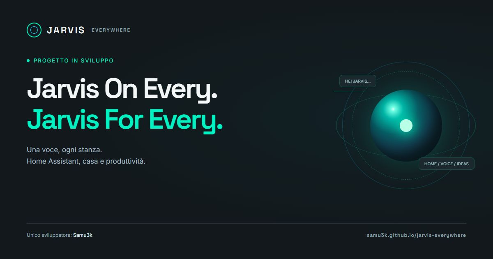

<div align="center">

# ◉ JARVIS EVERYWHERE

### Jarvis On Every. Jarvis For Every.

**La tua voce. La tua casa. Le tue idee.**

Un progetto per portare un assistente vocale open-source in ogni stanza,
con Home Assistant e strumenti di produttività al centro.


### [↗ Esplora il sito e prova la demo](https://samu3k.github.io/jarvis-everywhere/)

**[◉ Entra nella community Discord](https://discord.gg/hpz3j5Kqje)**



[La visione](#la-visione) · [Cosa esiste oggi](#cosa-esiste-oggi) · [Roadmap](#roadmap) · [Contribuire](#contribuire)

<sub>Unico sviluppatore: <a href="https://github.com/Samu3k">Samu3k</a> · Nome repository: <code>jarvis-everywhere</code></sub>

</div>

---

> **PROGETTO IN SVILUPPO.** Unico sviluppatore: **Samu3k**. Questa repository presenta la visione di JARVIS e una demo frontend simulata. Il motore vocale, il collegamento reale a Home Assistant e i servizi di produttività sono ancora da implementare.

## La visione

Immagina di entrare in salotto, in cucina o in studio e dire soltanto:

> «Hei Jarvis…»

Nessuna app da cercare, nessuna interfaccia da aprire. L’obiettivo è avere punti voce distribuiti nelle stanze e un assistente centrale capace di interpretare le richieste, usare gli strumenti giusti e rispondere dove ti trovi.

Home Assistant è il punto di partenza per la domotica. Musica, bozze email e task più articolati estenderanno l’esperienza oltre il controllo della casa.

**JARVIS** è il nome dell’assistente. **Jarvis Everywhere** esprime la direzione del progetto: renderlo presente e utile in tutta la casa.

## Un giorno, in casa

| Dove | Cosa vorresti dire | Esperienza desiderata |
| --- | --- | --- |
| Salotto | «Imposta il clima a 22 gradi» | Controllare il condizionatore tramite Home Assistant |
| Cucina | «Metti musica» | Riprodurre la musica nello spazio scelto |
| Studio | «Scrivi una bozza email» | Preparare un testo da rileggere e completare |
| Camera | «Serata relax» | Richiamare una sequenza di azioni personalizzata |
| Ogni stanza | «Qual è lo stato della casa?» | Ricevere un riepilogo dei dispositivi configurati |

Questi esempi descrivono l’obiettivo. La demo sul sito ne simula alcuni, senza eseguire azioni reali.

## Cosa esiste oggi

- Landing page responsive in **un unico `index.html`**, con CSS e JavaScript integrati.
- Interfaccia scura con accenti verde acqua/ciano, nucleo animato e anelli orbitali.
- Tema chiaro e scuro, con pulsante sole/luna animato e preferenza ricordata nel browser.
- Interfaccia completa in italiano e inglese, con selettore IT/EN: anche le risposte della demo cambiano lingua.
- Avviso «Progetto in sviluppo» e indicazione dell’unico sviluppatore nella prima schermata.
- Quattro ambienti illustrati e interattivi: salotto, cucina, studio e camera.
- Playground con comandi rapidi per clima, luci, musica, bozze email e stato della casa.
- Stato indipendente per stanza e scenari «Serata relax», «Concentrazione» e «Buonanotte».
- Controlli per la temperatura e interruttore delle luci nella dashboard simulata.
- Animazioni della forma d’onda, comparsa delle sezioni e supporto a `prefers-reduced-motion`.
- Storia del progetto, architettura esplorabile, diario dei progressi e roadmap interattiva.
- Compositore di idee: prepara una proposta, copiala oppure apri una issue GitHub precompilata, da rivedere e pubblicare personalmente.
- Collegamenti al server Discord, favicon e immagine di condivisione.
- Un piccolo Easter egg: prova a chiedere «Chi ti ha creato?».

La demo riconosce parole chiave italiane e inglesi e scenari predefiniti: **non è un modello AI**. Non usa il microfono, non riproduce musica, non controlla dispositivi e non invia email. I comandi e lo stato restano nella memoria della pagina e si azzerano ricaricandola. Solo tema e lingua vengono salvati in `localStorage`, quando disponibile. Il font viene richiesto a Google Fonts; le icone sono incorporate nel file.

### Prova qualche comando

```text
Hei Jarvis, imposta il clima a 24 gradi in cucina
Accendi le luci in salotto
Metti musica in salotto
Ferma la musica in salotto
Scrivi una bozza email in studio
Stato Home Assistant
Hei Jarvis, serata relax in camera
Hei Jarvis, modalità lavoro in studio
Hei Jarvis, buonanotte in camera
Chi ti ha creato?

Hey Jarvis, set the climate to 24 degrees in the kitchen
Play music in the living room
Write an email draft in the study
Hey Jarvis, relax evening in the bedroom
```

La temperatura accettata dalla demo va da 16 a 30 °C. Puoi scegliere una stanza dall’interfaccia o nominarla nel comando. Le bozze sono esempi predefiniti, non testi generati a partire da richieste libere.

## Architettura proposta

```text
Punti voce nelle stanze
        │
        ▼
Richiamo «Hei Jarvis» + riconoscimento vocale
        │
        ▼
Assistente centrale: interpretazione e instradamento
        │
        ├── Home Assistant → dispositivi, clima, scene
        ├── Musica → integrazione da scegliere
        └── Produttività → bozze email e strumenti futuri
        │
        ▼
Risposta vocale nella stanza di origine
```

Questo è uno schema di progetto, non uno stack già implementato. Restano da scegliere hardware dei punti voce, wake word engine, riconoscimento e sintesi vocale, modello AI, protocolli e servizi esterni. Il comportamento locale o cloud e la gestione dei dati saranno documentati insieme a queste scelte.

## Roadmap

### 01 — Presentazione e demo

- [x] Definire identità visiva e visione iniziale.
- [x] Realizzare la landing page e la demo simulata.
- [x] Esplorare scenari e stato per stanza nella demo.
- [x] Scrivere la documentazione iniziale.
- [x] Creare la repository e preparare i file per GitHub Pages.
- [x] Aggiungere temi chiaro/scuro e traduzione italiano/inglese.
- [x] Pubblicare il playground con luci, scenari e ambienti illustrati.
- [x] Collegare la community Discord e il compositore di proposte.

### 02 — Primo prototipo reale

- [ ] Scegliere e documentare lo stack voce.
- [ ] Collegare un ambiente di test a Home Assistant.
- [ ] Completare il percorso voce → intento → azione → risposta.
- [ ] Validare un primo punto voce in una stanza.
- [ ] Definire autenticazione, autorizzazioni e gestione dei dati.

### 03 — Multiroom e produttività

- [ ] Gestire punti voce e risposte in più stanze.
- [ ] Integrare la riproduzione musicale.
- [ ] Aggiungere strumenti per preparare bozze email.
- [ ] Richiedere conferma prima dell’eventuale invio di messaggi.
- [ ] Documentare installazione, configurazione e compatibilità hardware.

La roadmap è indicativa e non promette date di rilascio.

## Aprire la demo in locale

Scarica la repository e apri `index.html` nel browser. Non sono necessari installazione, compilazione, chiavi API o un server. Se Google Fonts non è disponibile, viene usato il font di sistema.

## Sito e pubblicazione

Il sito usa GitHub Pages, con origine **`main` → `/ (root)`**.

1. Modifica `index.html` per aggiornare testi, stile o interazioni.
2. Mantieni `favicon.svg` e `social-preview.jpg` nella cartella principale insieme al README.
3. Salva le modifiche sul branch `main`.
4. Attendi il completamento della pubblicazione di GitHub Pages.
5. Apri **[il sito JARVIS](https://samu3k.github.io/jarvis-everywhere/)** e verifica il risultato.

Riferimento: [documentazione ufficiale di GitHub Pages](https://docs.github.com/en/pages/getting-started-with-github-pages/creating-a-github-pages-site).

### Collegamenti del progetto

| Destinazione | Indirizzo previsto |
| --- | --- |
| Repository | https://github.com/Samu3k/jarvis-everywhere |
| Sito | https://samu3k.github.io/jarvis-everywhere/ |
| Playground | https://samu3k.github.io/jarvis-everywhere/#playground |
| Diario e roadmap | https://samu3k.github.io/jarvis-everywhere/#journal |
| Discord | https://discord.gg/hpz3j5Kqje |

Gli indirizzi `REPOSITORY` e `DISCORD_URL` si trovano nello script integrato in `index.html`. Quando cambi un indirizzo, aggiorna anche gli `href` espliciti e i collegamenti in questo README. Per una nuova destinazione del sito, aggiorna inoltre canonical e metadati Open Graph.

## Struttura iniziale

```text
jarvis-everywhere/
├── index.html          # Landing page, stile e playground interattivo
├── favicon.svg         # Icona vettoriale del progetto
├── social-preview.jpg  # Immagine di condivisione
└── README.md           # Visione, stato e collegamenti del progetto
```

## Contribuire

Sono benvenuti casi d’uso, test della demo, miglioramenti di accessibilità e proposte sulle integrazioni.

**[Entra nel Discord di JARVIS Everywhere](https://discord.gg/hpz3j5Kqje)** per consigli, idee e confronto sul progetto. Per proposte da seguire nel tempo, usa le [issue GitHub](https://github.com/Samu3k/jarvis-everywhere/issues) oppure il compositore disponibile sul sito.

- Apri una issue descrivendo il problema o lo scenario che immagini.
- Per modifiche ampie, discuti prima l’approccio in una issue.
- Nelle pull request indica cosa cambia e come hai verificato il risultato.

In questa fase sono particolarmente utili esperienze con Home Assistant, hardware audio, riconoscimento vocale e interazioni multiroom.

## Licenza

L’obiettivo è distribuire JARVIS come progetto open-source. **La licenza non è ancora stata scelta**: prima di presentare il codice come liberamente riutilizzabile verrà aggiunto un file `LICENSE` con i termini applicabili. Questa documentazione non assegna una licenza al progetto.

---

<div align="center">

**Jarvis su tutto, Jarvis per tutti.**

[◉ Torna al sito e prova la demo](https://samu3k.github.io/jarvis-everywhere/)

<sub>JARVIS — Unico sviluppatore: Samu3k · Progetto in sviluppo</sub>

</div>
